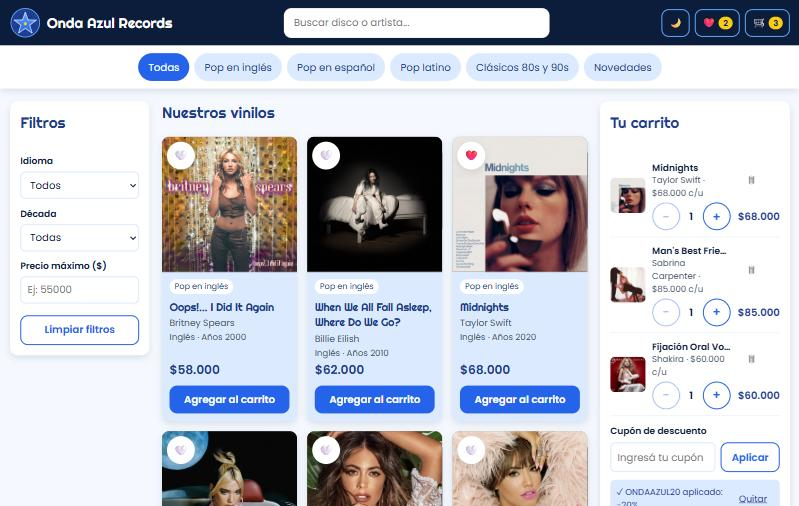
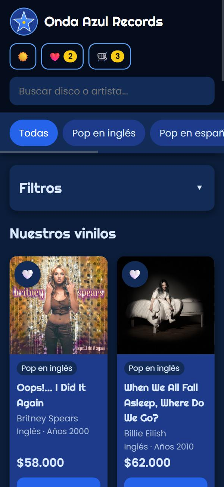

# 🌟 Onda Azul Records

**Onda Azul Records** es una tienda online de discos de vinilo de **pop en inglés y en español**.
Es un proyecto escolar hecho solo con **HTML, CSS y JavaScript** (sin frameworks ni librerías).

En la tienda hay 20 discos reales, organizados en 5 categorías: Pop en inglés, Pop en español, Pop latino, Clásicos 80s y 90s y Novedades.





---

## 🔗 Ver la tienda

👉 **Link:** _(completar cuando la publique en GitHub Pages)_

---

## ✅ Funcionalidades obligatorias

- **Mostrar los productos:** se ven los 20 discos en tarjetas, con la tapa, el nombre, el artista, el idioma, la década y el precio.
- **Categorías:** con los botones de arriba se ven solo los discos de una categoría.
- **Buscar:** el buscador encuentra discos por nombre o por artista. No importan las mayúsculas ni las tildes (por ejemplo, "fantasia" encuentra "Fantasía").
- **Filtrar:** por idioma, por década y por precio máximo. Los filtros se pueden combinar entre sí y con las categorías.
- **Carrito:**
  - agregar discos (si un disco ya está, se suma 1 a la cantidad),
  - cambiar la cantidad con los botones − y +,
  - eliminar un disco con 🗑 o vaciar todo el carrito,
  - ver el subtotal, el descuento y el total de la compra,
  - finalizar la compra.
- **Mensajes:** cada vez que hacés algo aparece un cartelito abajo que se va solo (por ejemplo, "«Midnights» agregado al carrito ✓"). Los mensajes normales son celestes y los avisos son amarillos.
- **Diseño responsive:** la página se adapta a la pantalla.
  - En la **computadora**: tres columnas (filtros, discos y carrito).
  - En la **tablet**: filtros y discos en dos columnas, y el carrito se abre como un panel desde la derecha.
  - En el **celular**: una columna, el header queda fijo arriba, los filtros se pliegan y el carrito también se abre como panel.

## ⭐ Funcionalidades opcionales

- 💾 **El carrito se guarda** con `localStorage`: si cerrás o recargás la página, sigue igual.
- 🌙 **Modo oscuro:** se activa con el botón 🌙 y la elección queda guardada. La primera vez usa la preferencia del dispositivo.
- ❤️ **Favoritos:** con el corazón de cada disco lo guardás en favoritos, y con el botón ❤️ del header ves solo tus favoritos. También se guardan.
- 🏷️ **Cupón de descuento:** ver abajo.

---

## 🏷️ Cupón de descuento

| Código | Descuento | Condición |
|---|---|---|
| **ONDAAZUL20** | 20% | Tener 3 discos o más en el carrito |

- No importan las mayúsculas ni los espacios: `ondaazul20` u `onda azul 20` también funcionan.
- Si aplicás el cupón con menos de 3 discos, queda guardado y el descuento empieza cuando llegás a 3.
- Si sacás discos y quedan menos de 3, el descuento vuelve a $0 (el cupón sigue guardado).
- Al vaciar el carrito o al finalizar la compra, el cupón se quita.

---

## 📁 Cómo está organizado el código

```
tienda-vinilos/
├── index.html      → estructura de la página
├── styles.css      → diseño
├── script.js       → funcionalidades
├── productos.js    → lista de discos
├── img/            → logo, tapas de los discos y capturas
├── NOTAS-IA.md     → registro de cómo usé la IA
└── README.md       → este archivo
```

| Archivo | Qué hace |
|---|---|
| `index.html` | Tiene la estructura: el header (logo, buscador y botones), las categorías, los filtros, el lugar donde van los discos, el carrito y el footer. Los discos no están escritos acá: los agrega JavaScript. |
| `styles.css` | Todo el diseño. Arriba están los colores como **variables** en `:root` (por ejemplo `--color-boton`), y el modo oscuro solo cambia el valor de esas variables. Al final están las reglas **responsive** para celular, tablet y computadora. |
| `productos.js` | La lista de los 20 discos. Cada disco tiene: `id`, `nombre`, `artista`, `categoria`, `idioma`, `decada`, `precio`, `tapa` (un degradado de respaldo por si la imagen no carga) e `imagen`. |
| `script.js` | Todas las funciones, ordenadas por secciones (ver abajo). |
| `img/` | El logo (`logo.svg`, hecho a mano en SVG), las 20 tapas y las capturas de este README. |

### Secciones de `script.js`

1. **Elementos y variables:** busca en la página los elementos que usa (botones, campos, etc.) y guarda el estado: la categoría elegida, el carrito, los favoritos y el cupón.
2. **Mostrar los discos:** `crearTarjeta()` arma la tarjeta de un disco y `mostrarProductos()` dibuja una tarjeta por cada disco de una lista.
3. **Búsqueda:** `buscar()` busca en todos los discos por nombre o artista.
4. **Filtros:** `aplicarFiltros()` usa `filter` para dejar solo los discos que cumplen todas las condiciones a la vez (categoría, idioma, década, precio y favoritos).
5. **Mensajes:** `mostrarMensaje()` muestra el cartelito y lo esconde solo con `setTimeout`.
6. **Carrito:** agregar, cambiar cantidad, eliminar, vaciar, calcular el total y finalizar la compra. Todas terminan llamando a `mostrarCarrito()`, que dibuja el carrito y lo guarda.
7. **Cupón:** `aplicarCupon()` revisa el código, `calcularDescuento()` calcula el 20% y el cupón se guarda en `localStorage`.
8. **Modo oscuro:** pone o saca la clase `modo-oscuro` en el `<body>` y guarda la elección.
9. **Favoritos:** agregar y sacar favoritos, ver solo los favoritos y guardarlos.
10. **Panel del carrito y filtros plegables:** abrir y cerrar el carrito en celular y tablet, y plegar los filtros en el celular.
11. **Guardado del carrito (`localStorage`):** guardar y cargar el carrito. Si no hay nada guardado (o está roto), empieza vacío.
12. **Eventos e inicio:** conecta cada botón con su función y, al cargar la página, muestra todo.

---

## 🛠️ Tecnologías

- HTML, CSS y JavaScript "vanilla" (sin frameworks ni librerías).
- Tipografías de Google Fonts: **Righteous** (títulos) y **Poppins** (texto).
- `localStorage` para guardar los datos en el navegador.

## 💻 Cómo abrirla en tu computadora

1. Descargá o cloná este repositorio.
2. Abrí el archivo `index.html` con el navegador (doble clic).

No hace falta instalar nada.

---

## 💿 Sobre las tapas de los discos

Los discos y artistas de la tienda son **reales**. Las tapas **pertenecen a sus artistas y sellos discográficos** y se usan **solo con fines educativos**, para este proyecto escolar. No es una tienda real: no se vende nada.

---

## 🤖 Cómo usé la IA

